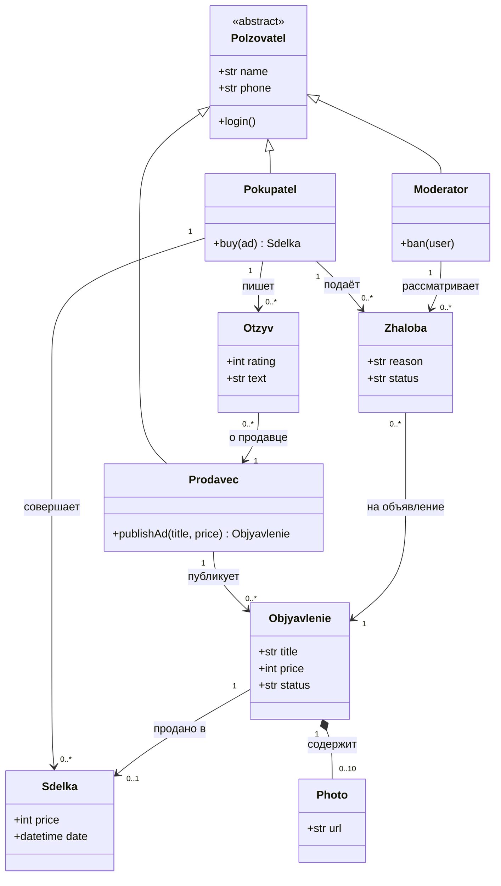
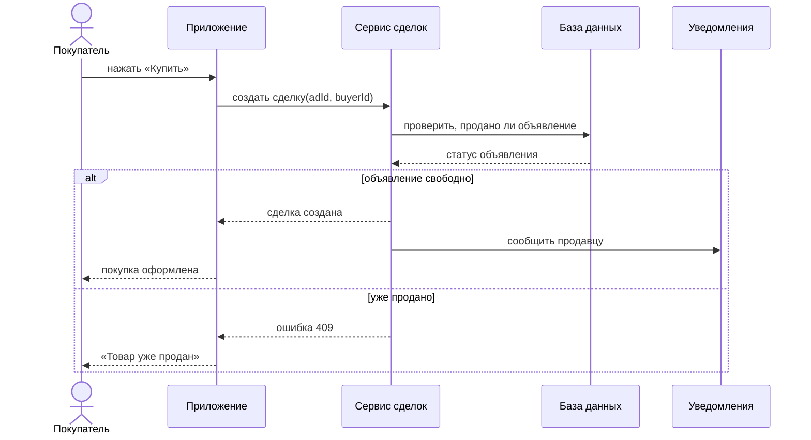
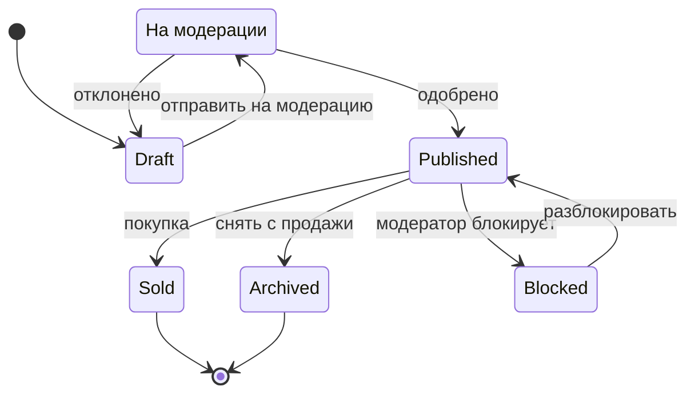
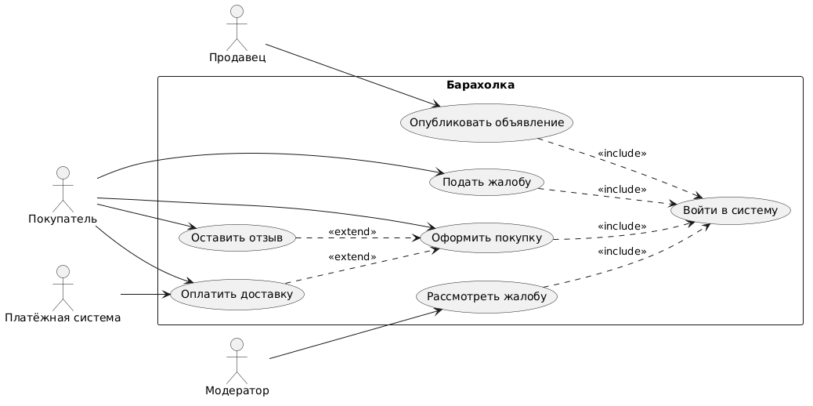

# Барахолка

Учебный проект по ООАП. Диаграммы хранятся как код в `docs/diagrams`.

## Архитектура

### Диаграмма классов

### Диаграмма последовательности «Купить»

### Жизненный цикл объявления

### Диаграмма прецедентов (PlantUML)

Исходник: [usecase.puml](docs/diagrams/usecase.puml). PNG получается так: вставить текст на plantuml.com/plantuml и скачать картинку.
